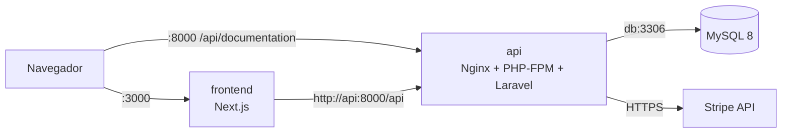

## Servicio Backend — API Laravel

### Arquitectura de contenedores



Los tres servicios comparten la red `tiendita-net`. Solo `frontend` y `api` publican puertos al host; MySQL no se expone y solo es accesible desde la red interna.

### Decisiones técnicas del Dockerfile del backend

| Decisión | Motivo |
|---|---|
| **Build multi-stage** (`composer:2` → `php:8.2-fpm-alpine`) | Composer, git y las dependencias de desarrollo nunca llegan a la imagen final. Solo se copia `vendor/`. |
| **Manifiestos copiados primero** (`composer.json` + `composer.lock`) | La capa de `composer install` se cachea y solo se reconstruye si cambian las dependencias, no con cada cambio de código. |
| **Imagen base Alpine** | Menor tamaño y menor superficie de ataque que las variantes Debian. |
| **Extensiones** | `mbstring`, `openssl`, `tokenizer`, `xml`, `ctype` y `json` ya vienen compiladas en la imagen oficial de PHP; solo se instala `pdo_mysql` (más `opcache`). Un paso del build verifica con `php -m` que las siete estén presentes y falla si falta alguna. |
| **Nginx + PHP-FPM en un solo contenedor** | El ecosistema pide un servicio por componente; Nginx actúa como proxy inverso hacia FPM en `127.0.0.1:9000`. |
| **Solo `index.php` es ejecutable** | Cualquier otro `.php` responde 404 y los archivos ocultos (`.env`, `.git`) están bloqueados. |
| **Código de solo lectura** | El código pertenece a `root`; solo `storage/` y `bootstrap/cache/` son escribibles por `www-data`. |
| **Sin `.env` dentro de la imagen** | Los secretos se inyectan en runtime desde `docker-compose.yml`. `.dockerignore` excluye `.env*`. |
| **Cachés de Laravel en runtime** | `artisan optimize` se ejecuta al arrancar porque depende de variables de entorno que no existen durante el build. |
| **OPcache con `validate_timestamps=0`** | La imagen es inmutable, así que PHP no necesita revisar si los archivos cambiaron. |
| **Logs a stdout/stderr** | `docker compose logs` muestra Nginx, PHP-FPM y Laravel. |
| **`HEALTHCHECK` sobre `/up`** | Permite que otros servicios usen `depends_on: condition: service_healthy`. |
| **`.dockerignore`** | Un contexto de build más pequeño y sin `vendor/`, `.git` ni `.env`. |

### Variables de entorno del contenedor `api`

Documentadas en `.env.example`. Las migraciones corren al arrancar (`RUN_MIGRATIONS=true`). Los seeders se ejecutan manualmente una sola vez:

```bash
docker compose exec -u www-data api php artisan db:seed --force
```