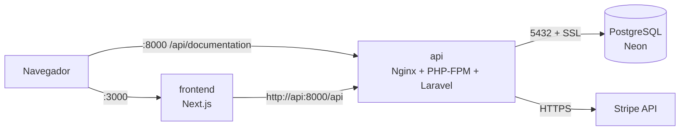

## Servicio Backend — API Laravel

API REST de la tiendita (Laravel 12, Sanctum, Stripe y Swagger) empaquetada en un contenedor con Nginx + PHP-FPM. La base de datos **no corre en un contenedor**: es una instancia de **PostgreSQL alojada en Neon**, creada y mantenida por el equipo.

### Arquitectura



Los servicios de Docker comparten la red `tiendita-net`. Solo `api` (y `frontend`, cuando se agregue) publican puertos al host. La base de datos es externa: el contenedor se conecta a Neon por internet usando SSL obligatorio.

### Cómo levantarlo

1. Copia `.env.example` a `.env` en la raíz del repositorio y completa los valores (los reales de Neon y de Stripe se piden por privado; **nunca se suben a Git**).
2. Genera el `APP_KEY` y pégalo en `.env`:

   ```bash
   docker compose run --rm api php artisan key:generate --show
   ```

3. Construye y arranca:

   ```bash
   docker compose up -d --build
   docker compose logs -f api
   ```

4. Comprueba que funciona:
   - Salud: <http://localhost:8000/up>
   - Documentación Swagger: <http://localhost:8000/api/documentation>
   - Catálogo: <http://localhost:8000/api/products>

### Base de datos (PostgreSQL en Neon)

- El esquema (usuarios, categorías, marcas, productos, órdenes, cupones…) ya existe en Neon. Laravel **no lo recrea**.
- La única tabla que crea Laravel es `personal_access_tokens` (tokens de Sanctum), mediante una migración que primero comprueba si la tabla ya existe. También aparece la tabla `migrations`, que Laravel crea para llevar su registro.
- Sesiones, caché y colas no usan la base de datos (`SESSION_DRIVER=array`, `CACHE_STORE=file`, `QUEUE_CONNECTION=sync`) porque Neon no tiene esas tablas.
- Usa el host **directo** de Neon (el que no lleva `-pooler`): el pooler (PgBouncer) puede romper las migraciones.
- `DB_SSLMODE=require` es obligatorio; Neon rechaza conexiones sin SSL.
- **No ejecutes `migrate:fresh` contra Neon:** borraría las tablas de todo el equipo. Las pruebas que se hagan en Swagger (usuarios, órdenes) quedan guardadas en la base compartida.
- Los seeders están vacíos a propósito, porque la base ya trae sus datos. Por eso `RUN_SEED=false`.

### Decisiones técnicas del Dockerfile del backend

| Decisión | Motivo |
|---|---|
| **Build multi-stage** (`composer:2` → `php:8.2-fpm-alpine`) | Composer, git y las dependencias de desarrollo nunca llegan a la imagen final. Solo se copia `vendor/`. |
| **Manifiestos copiados primero** (`composer.json` + `composer.lock`) | La capa de `composer install` se cachea y solo se reconstruye si cambian las dependencias, no con cada cambio de código. |
| **Imagen base Alpine** | Menor tamaño y menor superficie de ataque que las variantes Debian. |
| **Extensiones** | `mbstring`, `openssl`, `tokenizer`, `xml`, `ctype` y `json` ya vienen compiladas en la imagen oficial de PHP. Se instalan `pdo_pgsql` (necesaria para Neon), `pdo_mysql` y `opcache`. Las dependencias de compilación (`postgresql-dev`) se instalan como paquete virtual y se eliminan en el mismo paso; solo queda `libpq` en tiempo de ejecución. Un paso del build verifica con `php -m` que las extensiones requeridas estén presentes y falla si falta alguna. |
| **Nginx + PHP-FPM en un solo contenedor** | El ecosistema pide un servicio por componente; Nginx actúa como proxy inverso hacia FPM en `127.0.0.1:9000`. |
| **Solo `index.php` es ejecutable** | Cualquier otro `.php` responde 404 y los archivos ocultos (`.env`, `.git`) están bloqueados. |
| **Código de solo lectura** | El código pertenece a `root`; solo `storage/` y `bootstrap/cache/` son escribibles por `www-data`. |
| **Sin `.env` dentro de la imagen** | Los secretos se inyectan en runtime desde `docker-compose.yml`. `.dockerignore` excluye `.env*`. |
| **Cachés de Laravel en runtime** | `artisan optimize` se ejecuta al arrancar porque depende de variables de entorno que no existen durante el build. |
| **OPcache con `validate_timestamps=0`** | La imagen es inmutable, así que PHP no necesita revisar si los archivos cambiaron. |
| **Logs a stdout/stderr** | `docker compose logs` muestra Nginx, PHP-FPM y Laravel. |
| **`HEALTHCHECK` sobre `/up`** | Permite que otros servicios usen `depends_on: condition: service_healthy`. |
| **`.dockerignore`** | Un contexto de build más pequeño y sin `vendor/`, `.git` ni `.env`. |
| **Documentación Swagger con docblocks** | l5-swagger 11 solo lee atributos de PHP 8 por defecto. `AppServiceProvider` configura en tiempo de ejecución un analizador que también lee los comentarios `@OA`. Se hace ahí y no en `config/` para que `config:cache` no tenga que serializar un objeto. |

### Variables de entorno del contenedor `api`

Están documentadas en `.env.example`. Las principales:

| Variable | Para qué sirve |
|---|---|
| `DB_HOST`, `DB_PORT`, `DB_DATABASE`, `DB_USERNAME`, `DB_PASSWORD` | Conexión a PostgreSQL en Neon (host directo, sin `-pooler`). |
| `DB_SSLMODE` | `require` (obligatorio en Neon). |
| `APP_KEY` | Clave de cifrado de Laravel; se genera con `php artisan key:generate --show`. |
| `STRIPE_KEY`, `STRIPE_SECRET` | Claves de Stripe en modo test. |
| `L5_SWAGGER_CONST_HOST` | URL base del servidor en Swagger, **sin** `/api` (las rutas ya lo incluyen). |
| `RUN_MIGRATIONS` | Si es `true`, ejecuta `php artisan migrate` al arrancar. Con Neon solo crea la tabla de tokens si falta. |
| `RUN_SEED` | Déjalo en `false`: la base de Neon ya trae sus datos. |
| `GENERATE_SWAGGER` | Si es `true`, regenera la documentación Swagger al arrancar. |

### Probar la API desde Swagger

1. Abre <http://localhost:8000/api/documentation>.
2. `GET /api/products` es público: pulsa **Try it out** → **Execute**.
3. Registra un usuario con `POST /api/register` e inicia sesión con `POST /api/login`.
4. Copia el `token` de la respuesta, pulsa **Authorize** y pégalo (sin escribir `Bearer`).
5. Con el token ya puedes usar las rutas protegidas, como `POST /api/orders` (para pagar en modo test usa la tarjeta `pm_card_visa` de Stripe).

### Comandos útiles

```bash
docker compose logs -f api                 # ver logs
docker compose exec api sh                 # entrar al contenedor
docker compose run --rm api php artisan route:list
docker compose up -d --build               # reconstruir tras cambiar código
docker compose down                        # detener
```
